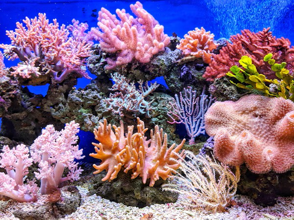
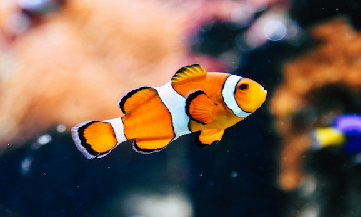
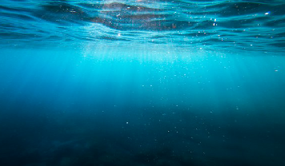
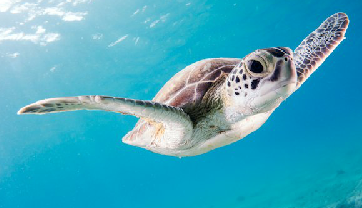
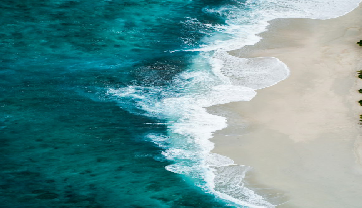

<TRABAJO REALIZADO POR DAVID GONZALEZ DOMINGO Y LESLY RODRIGUEZ ALARCON>
<html lang="es">
<head>
    <meta charset="UTF-8">
    <title>Acuarios que puedes visitar en México</title>

    
</head>

<body>

    <header id="inicio">
        <h1>ACUARIOS DE MÉXICO</h1>
        
Descubre la belleza de la vida marina

    </header>

    <nav>
        <a href="#inicio">Inicio</a>
        <a href="#acuario">Acuarios</a>
        <a href="#tabla">Información</a>
        <a href="#cuidado">Cuidado del mar</a>
    </nav>

    <section>
        <h2>Bienvenidos a mi página web</h2>

        

            México cuenta con lugares increíbles donde podemos conocer
            diferentes especies marinas. Los acuarios nos permiten
            aprender sobre los peces, tiburones, tortugas y otros
            animales que viven en el agua.
        

        

            En esta página encontrarás información sobre algunos
            acuarios que puedes visitar en nuestro país, así como
            enlaces para conocer más sobre ellos.
        

        

          
        

    </section>

    <section id="acuario">
        <h2>1. Acuario Inbursa</h2>

        
<b>Ubicación:</b> Ciudad de México.

        

            Es uno de los lugares que puedes visitar para conocer
            diferentes especies marinas y aprender sobre la vida
            en los océanos. Es una opción para ir con la familia.
        

        

                     
            <a class="boton" href="https://www.acuarioinbursa.com.mx/"
               target="_blank">Conocer el acuario</a>
        

        

        <h2>2. Acuario Michin</h2>

        
<b>Ubicación:</b> cuenta con sedes en distintas ciudades de México.

        

            Es un espacio de entretenimiento y aprendizaje donde
            puedes conocer especies animales y participar en
            actividades relacionadas con la naturaleza.
        

        

                     
            <a class="boton" href="https://www.acuariomichin.com/"
               target="_blank">Visitar sitio web</a>
        

        

        <h2>3. Acuario de Veracruz</h2>

        
<b>Ubicación:</b> Veracruz, México.

        

            Veracruz se encuentra junto al Golfo de México y tiene
            una gran riqueza natural. Puedes consultar información
            sobre lugares para conocer la vida marina en esta ciudad.
        

        

                     
            <a class="boton"
               href="https://www.google.com/maps/search/?api=1&query=Acuario+de+Veracruz"
               target="_blank">Ver ubicación</a>
        

        

        <h2>4. Acuarios de Mazatlán</h2>

        
<b>Ubicación:</b> Mazatlán, Sinaloa.

        

            Mazatlán es un destino turístico conocido por sus playas
            y su relación con el océano Pacífico. Es una buena opción
            para buscar actividades relacionadas con la vida marina.
        

        

                     
            <a class="boton"
               href="https://www.google.com/maps/search/?api=1&query=Acuario+Mazatlan"
               target="_blank">Ver lugares en el mapa</a>
        

    </section>

    <section id="tabla">
        <h2>Información de los acuarios</h2>

        <table>
            <tr>
                <th>Acuario o destino</th>
                <th>Estado</th>
                <th>Actividad principal</th>
            </tr>

            <tr>
                <td>Acuario Inbursa</td>
                <td>Ciudad de México</td>
                <td>Conocer especies marinas</td>
            </tr>

            <tr>
                <td>Acuario Michin</td>
                <td>Varias ciudades</td>
                <td>Aprendizaje y entretenimiento</td>
            </tr>

            <tr>
                <td>Acuario de Veracruz</td>
                <td>Veracruz</td>
                <td>Explorar la vida marina</td>
            </tr>

            <tr>
                <td>Acuarios de Mazatlán</td>
                <td>Sinaloa</td>
                <td>Actividades relacionadas con el mar</td>
            </tr>
        </table>
    </section>

    <section id="cuidado">
        <h2>¿Cómo podemos cuidar la vida marina?</h2>

        

            Es importante proteger los océanos porque muchos animales
            dependen de ellos para vivir. Todos podemos ayudar con
            acciones sencillas.
        

        <ul>
            <li>No tirar basura en las playas.</li>
            <li>Reducir el uso de plásticos.</li>
            <li>No molestar a los animales marinos.</li>
            <li>Cuidar el agua y evitar contaminarla.</li>
        </ul>

        

            Cuidar el mar es responsabilidad de todos y ayuda a
            conservar la biodiversidad de nuestro planeta.
        

    </section>

    <footer>
        
Proyecto escolar: Acuarios de México

        
Conoce, aprende y cuida la vida marina.

        <a href="#inicio" style="color: white;">Volver al inicio</a>
    </footer>

</body>
</html>
